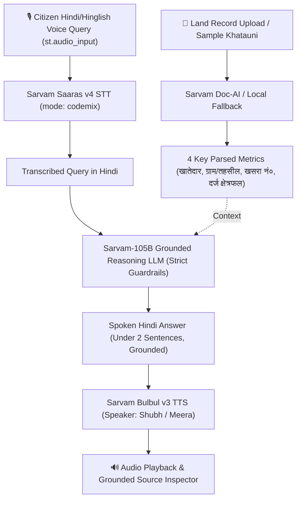

# BhoomiVoice 🌾 (भूमिवाणी)

**Assistive Voice Agent for Indian Land Records (Khatauni / Patta) Powered by Sarvam AI & Streamlit**

[](https://docs.sarvam.ai)
[](https://python.org)
[](https://streamlit.io)
[](LICENSE)

---

### ⚠️ Legal Disclaimer / विधिक सूचना
> **"सूचना: यह केवल राजस्व अभिलेख पढ़ने का सहायक है, कानूनी स्वामित्व का प्रमाण नहीं।"**  
> BhoomiVoice is an accessibility and readability tool designed to help rural citizens understand government revenue land records (Khatauni, R.C. Form 11, Patta). It strictly refrains from making legal ownership assertions and refers only to **दर्ज खातेदार (Recorded Holder)**.

---

## 🏗️ Architecture & Pipeline Flow



---

## 🚀 Local Setup & Quickstart

Follow these steps to run BhoomiVoice locally on your machine.

### 1. Clone the Repository
```bash
git clone https://github.com/AdiAce4u/BhoomiVoice.git
cd BhoomiVoice
```

### 2. Create and Activate a Virtual Environment
```bash
# Windows
python -m venv .venv
.venv\Scripts\activate

# macOS / Linux
python3 -m venv .venv
source .venv/bin/activate
```

### 3. Install Dependencies
```bash
pip install -r requirements.txt
```

### 4. Configure Environment Variables
Copy the template configuration file to `.env`:

```bash
# Windows (Command Prompt / PowerShell)
copy .env.example .env

# macOS / Linux
cp .env.example .env
```

Open `.env` and add your [Sarvam AI](https://dashboard.sarvam.ai) API key:
```env
SARVAM_API_KEY=your_actual_sarvam_api_key_here
```

> **Note:** `.env` is listed in `.gitignore` and will never be committed to source control.

### 5. Launch the Streamlit App
```bash
streamlit run app.py
```
The application will automatically open in your browser at `http://localhost:8501`.

---

## 📂 Project Structure

```text
BhoomiVoice/
├── app.py                   # Main Streamlit web application & UI
├── sample_data.json         # Preloaded authentic Khatauni data for offline fallback
├── sample_khatauni.png      # Sample document image for testing OCR upload
├── requirements.txt         # Project dependencies
├── .env.example             # Environment variable template
├── .gitignore               # Files and secrets excluded from Git
└── README.md                # Documentation & architecture guide
```

---

## 🎯 Sarvam AI Integration Details

| Capability | Model / Endpoint | Method | Role in BhoomiVoice |
| :--- | :--- | :--- | :--- |
| **STT** | `saaras:v4` (`https://api.sarvam.ai/speech-to-text`) | `POST` | Transcribes spoken Hindi/Hinglish queries with dialect and code-mixed resilience. |
| **Document AI** | `https://api.sarvam.ai/doc-ai/v1/job/extract` | `POST` | Reads PDF/JPG land records with zero-delay local fallback to `sample_data.json`. |
| **Grounded LLM** | `sarvam-105b` (`https://api.sarvam.ai/v1/chat/completions`) | `POST` | Indic reasoning LLM strictly restricted to document context. Refers exclusively to *दर्ज खातेदार*. |
| **TTS** | `bulbul:v3` (`https://api.sarvam.ai/text-to-speech`) | `POST` | Expressive natural Hindi voice synthesis with `shubh` (Male) and `meera` (Female) voices. |

---

## 🛡️ Built-in Resilience & Guardrails

- **Zero-Latency Fallback**: If the network is interrupted or Doc-AI times out, preloaded `sample_data.json` immediately ensures 100% demo continuity.
- **Dual Input Modes**: Seamlessly switch between microphone input (`st.audio_input`) and text queries with quick-select prompt chips.
- **Strict Grounding Guardrail**: System prompt strictly outputs: `"दस्तावेज़ में यह जानकारी उपलब्ध नहीं है।"` if a requested field isn't in the document, preventing hallucinations.
- **Secret Isolation**: Loads keys exclusively from `.env` via `python-dotenv` and never displays secrets in the frontend.
