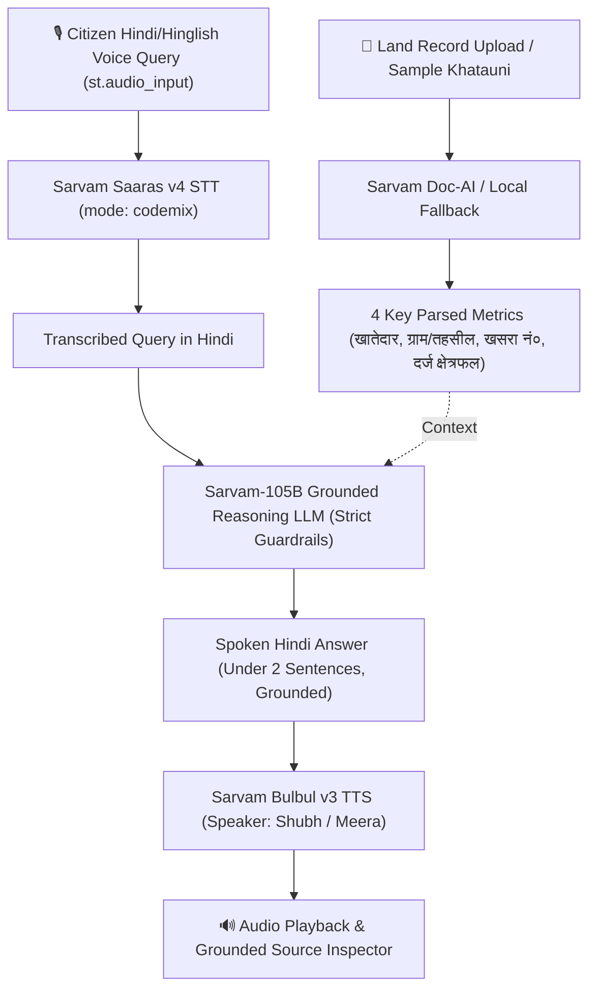

# BhoomiVoice 🌾 (भूमिवाणी)

**Assistive Voice Agent for Indian Land Records (Khatauni / Patta) Powered by Sarvam AI & Streamlit**

[](https://docs.sarvam.ai)
[](https://python.org)
[](https://streamlit.io)

---

### ⚠️ Legal Disclaimer / विधिक सूचना
> **"सूचना: यह केवल राजस्व अभिलेख पढ़ने का सहायक है, कानूनी स्वामित्व का प्रमाण नहीं।"**  
> BhoomiVoice is an accessibility and readability tool designed to help rural citizens understand government revenue land records (Khatauni, R.C. Form 11, Patta). It strictly refrains from making legal ownership assertions and refers only to **दर्ज खातेदार (Recorded Holder)**.

---

## 🏗️ Architecture & Pipeline Flow



---

## ⚡ Quickstart (Zero-Friction 2-Minute Setup)

### 1. Requirements & Environment
Make sure your `SARVAM_API_KEY` is present in `.env`:
```bash
SARVAM_API_KEY=your_actual_sarvam_api_key_here
```

### 2. Install Dependencies
```bash
pip install -r requirements.txt
```

### 3. Launch BhoomiVoice Streamlit App
```bash
streamlit run app.py
```
Or with custom port:
```bash
python -m streamlit run app.py --server.port 8501
```

---

## 🎯 Sarvam AI Integration Details

| Capability | Model / Endpoint | Method | Role in BhoomiVoice |
| :--- | :--- | :--- | :--- |
| **STT** | `saaras:v4` (`https://api.sarvam.ai/speech-to-text`) | `POST` | Transcribes spoken Hindi/Hinglish queries with dialect and code-mixed resilience. |
| **Document AI** | `https://api.sarvam.ai/doc-ai/v1/job/extract` | `POST` | Reads PDF/JPG land records with zero-delay local fallback to `sample_data.json`. |
| **Grounded LLM** | `sarvam-105b` (`https://api.sarvam.ai/v1/chat/completions`) | `POST` | Reasoning model strictly restricted to the document context. Never invents ownership. |
| **TTS** | `bulbul:v3` (`https://api.sarvam.ai/text-to-speech`) | `POST` | Expressive natural Hindi voice synthesis with `shubh` (Male) and `meera` (Female) voices. |

---

## 🛡️ Built-in Resilience & Guardrails
- **Instant Fallback**: If network is offline or Doc-AI times out, preloaded `sample_data.json` immediately ensures 100% demo continuity.
- **Microphone Fallback**: Both `st.audio_input` and keyboard text queries + quick preset buttons are available.
- **Strict Grounding**: System prompt strictly outputs: `"दस्तावेज़ में यह जानकारी उपलब्ध नहीं है।"` if field isn't present, preventing hallucinations.
- **No Hardcoded Secrets**: Reads exclusively from `.env` via `python-dotenv` and never leaks keys to the UI.
